# Wind Farm Energy Production Analysis

## Executive Summary

During this project, I analyzed 7 days of wind farm operational data (2026-03-01 to 2026-03-07) to evaluate energy production, turbine performance, operational stops, and potential energy losses.

The wind farm consists of 6 turbines, which generated a total of 642.33 MWh during the analyzed period.

During the investigation, I found several important results:

1. Estimated energy shortfall: Approximately 92.06 MWh, including theoretical losses during high-wind shutdowns, which are not considered recoverable.

2. T04 underperformance: T04 generated approximately 9.69% less energy than expected, representing a production deficit of 10.22 MWh during normal operation.

3. Grid limitations (GRD): Three GRD events were identified, causing immediate production drops of approximately 75–90%.

4. Turbine downtime: Total recorded downtime was 72 hours, representing 7.14% of the combined available operating time across all turbines.

## Park-Level Performance
During the 7-day period (2026-03-01 to 2026-03-07), the wind farm generated a total of 642.33 MWh of energy.

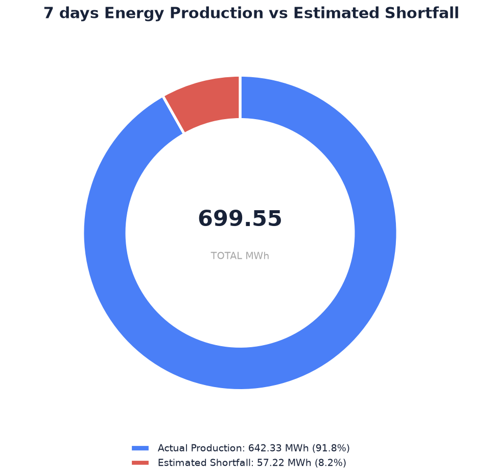

During this period, different types of operational stops were recorded, including park-level grid limitations (GRD), hydraulic technical faults (FLT), scheduled maintenance (MTN), and high-wind shutdowns (WND).

The chart below shows the total energy production of the wind farm during the analyzed period.

During further investigation of GRD events, I identified 3 different events and compared the energy production immediately before and during each event.

The analysis showed significant drops in energy production:

    1. First GRD event: approximately 90.25% decrease.

    2. Second GRD event: approximately 81.38% decrease.

    3. Third GRD event: approximately 74.97% decrease.

Based on these results, I suspect that dynamic power limiting might have been applied. However, this would require further investigation to confirm.

One possible explanation could be controlled power reduction and gradual power ramp-up after grid restrictions are removed. This could help restore production safely and reduce the risk of unexpected shutdowns or technical issues.

The chart below compares energy production before and during each GRD event.

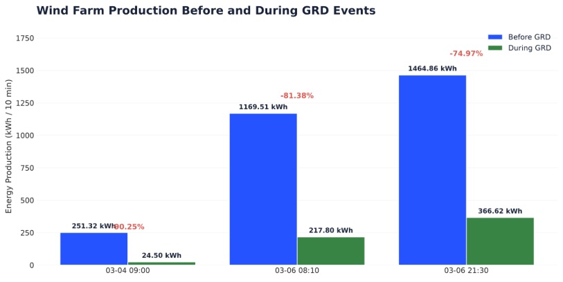

During the analysis, I also found that the maximum recorded energy production of a single turbine was 252.5 kWh per 10 minutes.

If all 6 turbines generated this amount simultaneously, the theoretical maximum production of the wind farm would be 1515 kWh per 10 minutes.

Before the third GRD event, the wind farm generated 1464.86 kWh per 10 minutes, which represents approximately 96.7% of this theoretical maximum.

This suggests that the wind farm was operating close to its observed maximum production level before the third GRD event.

However, the three GRD events occurred at different production levels, so further investigation would be necessary to understand how the grid limitations were applied.

Finally, I calculated the estimated energy losses for the entire wind farm based on different stop events and unexplained production differences.

## Turbine-Level Performance
During turbine-level analysis, I compared all 6 turbines to understand how much energy each turbine generated and how different operational events affected their performance.

First, I compared the total energy production of each turbine to identify which turbines generated the most and the least energy during the 7 days.
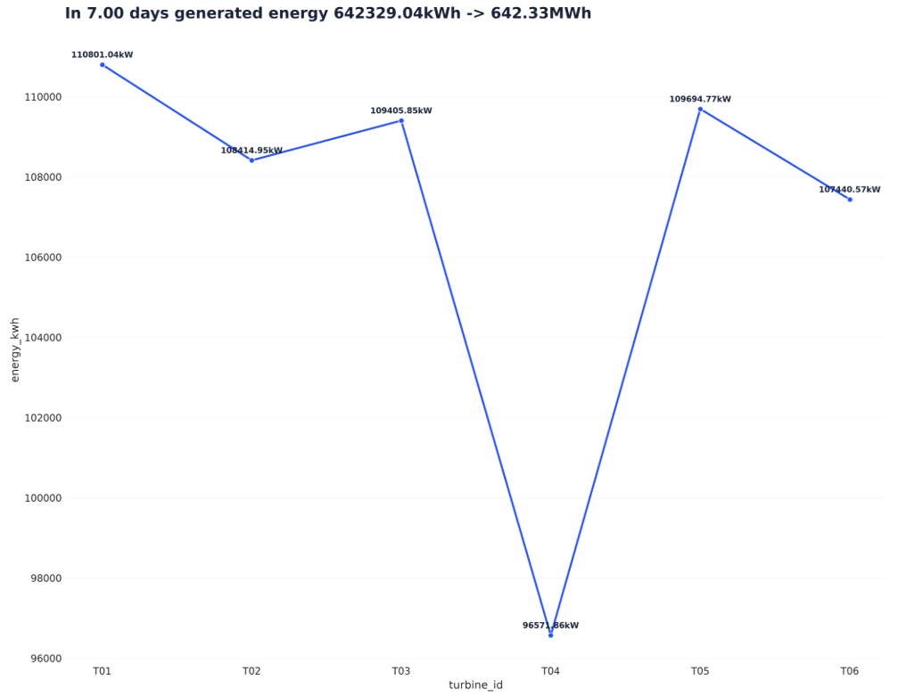

After that, I analyzed turbine availability to understand how much time each turbine was available for energy production. Threshold 90% was selected as an example, in real world value can vary. This information could be usefull for investors and consumers.
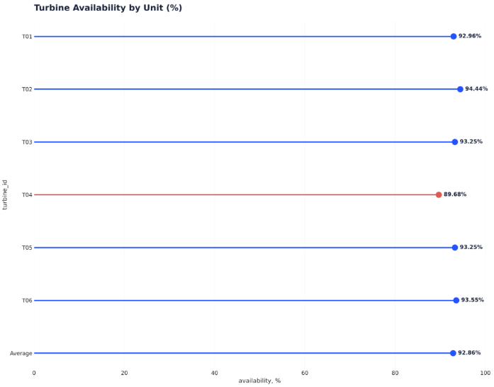

Also, I compared the number of stops for each turbine to identify which turbines experienced more operational interruptions. We can see, that it's quite hard to see correlation between how long ago service was provided to turbine and the operational interruptions.
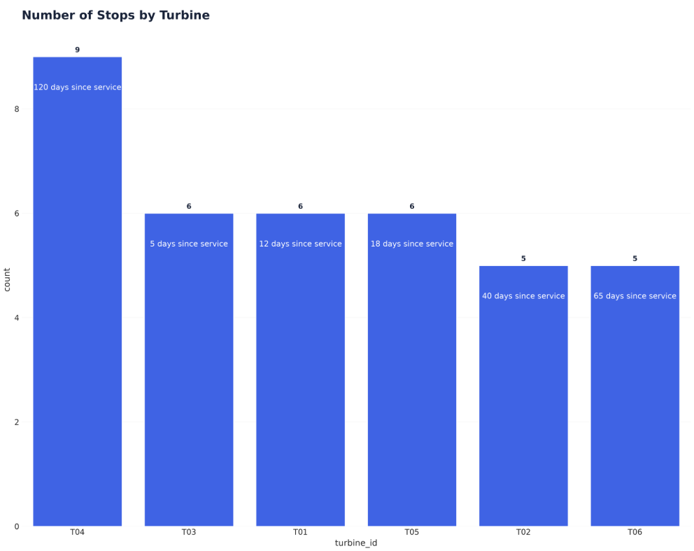

The chart includes a theoretical energy shortfall during high-wind shutdowns (WND), assuming that each turbine could generate 252.5 kWh per 10-minute interval. However, this is only a hypothetical scenario, as turbines must shut down during extreme wind conditions for safety reasons. Therefore, these values should not be considered recoverable energy losses. 
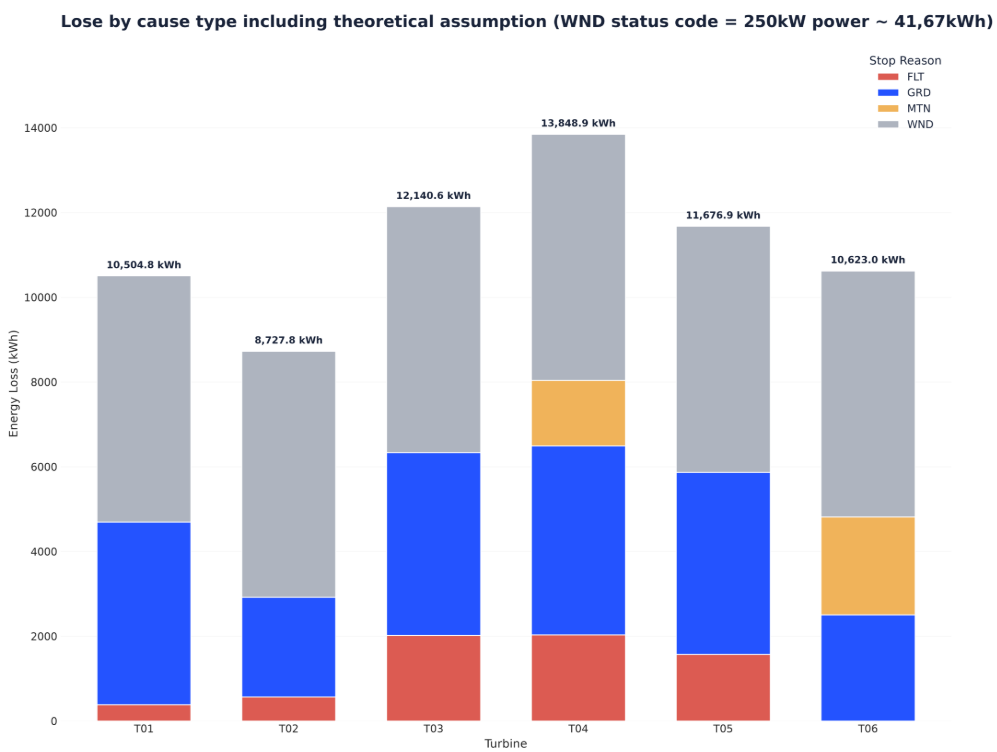

Excluding theoretical WND losses, T04 shows the highest estimated shortfall (17.83 MWh), mainly due to unexplained underperformance. Grid limitations (GRD) also contribute significantly, highlighting areas for further investigation.
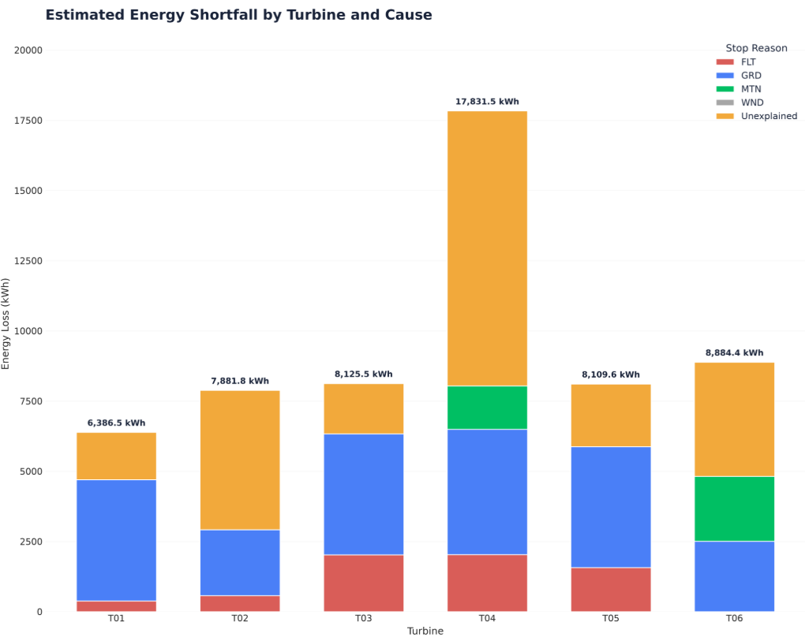

I also compared energy production at different wind speeds to understand how efficiently each turbine was operating.

The chart below shows that T04 generated less energy than the other turbines at similar wind speeds. The difference is especially noticeable at higher wind speeds, where most turbines generated around 245–252 kWh per 10 minutes, while T04 generated approximately 225 kWh.
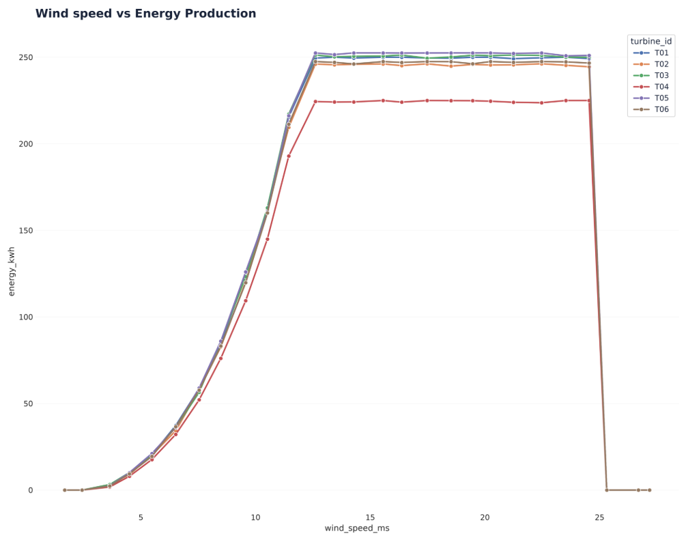

Also I tried to visualize estimated energy losses were distributed across different wind speeds for each turbine.

The heatmap below shows that the highest estimated losses were mainly recorded at wind speeds between 9 and 14 m/s. T04 had significantly higher losses compared with the other turbines, especially at wind speeds between 10 and 13 m/s.

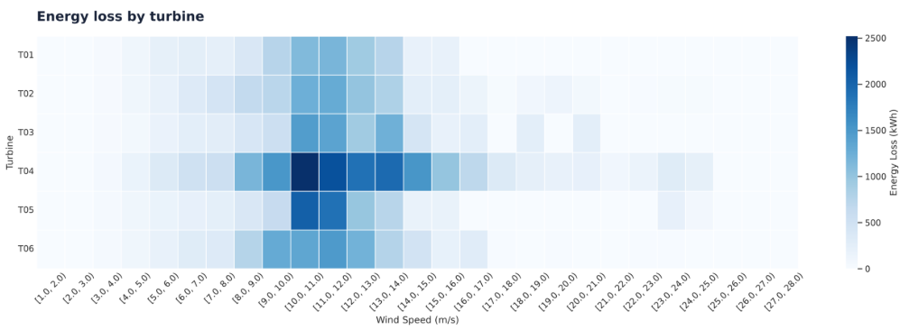

This supports the previous findings that T04 may be operating less efficiently than the other turbines. However, further investigation would be necessary to identify the actual reasons for these differences.

During further investigation, I found that T04 showed signs of underperformance. Based on the median production of the other turbines at similar wind speeds, T04 was expected to generate 105.44 MWh, but instead generated only 95.22 MWh during normal operation.

It means that T04 had an estimated production deficit of 10.22 MWh (9.69%) compared with the other turbines. I would investigate this turbine in more detail to understand whether the difference was caused by technical issues, operational settings, or other factors

## Data Quality & Operational Events

During data investigations it was found that:

1. In the stop_logs dataset, 2 duplicated rows were detected.
2. In the stop_logs dataset, the column name ' timestamp_start' contained an unnecessary leading space.
3. In the stop_logs dataset, 4 NaN (Not a Number) values were found in the timestamp_end column.
4. During the analysis of the weather dataset, 54 outliers were detected in the wind_speed_ms column using the IQR method. However, these values were not automatically considered data errors.

Operational Events:

1. The duplicated rows were removed.
2. The unnecessary space in the column name was removed.
3. To solve the missing values problem, I checked turbines with the same timestamp_start and stop_code to see whether their timestamp_end values were available. Since matching values were found, all 4 missing values were replaced. If no matching values had been found, I would have preferred to remove those rows, because even a small difference in stop duration could have a significant impact on the overall park analysis.

After cleaning the datasets, I also analyzed categorical and continuous variables and summarized their descriptive statistics in tables to get a more detailed overview of the data.

Below there is provided a table with data analysis (after cleaning):
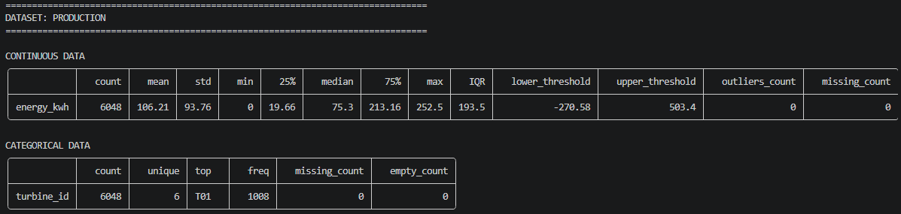
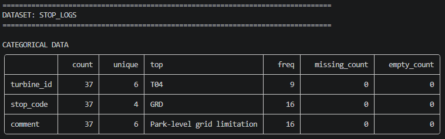
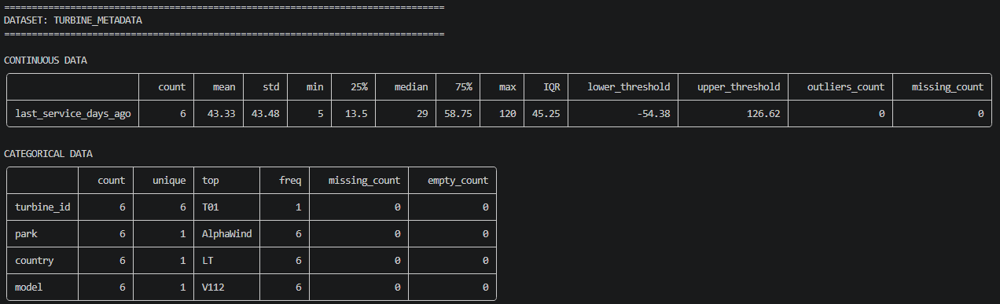
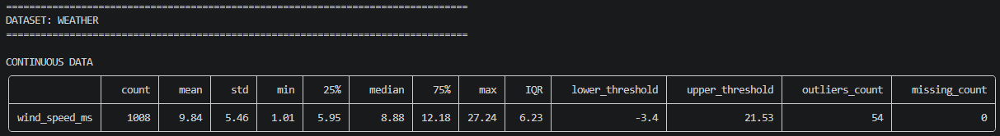

During further investigation, I found that the total downtime recorded in the stop_logs dataset was 72 hours, representing 7.14% of the total available turbine operating time (1008 hours per week across all 6 turbines). The analysis also showed that park-level grid limitations had the biggest impact on overall downtime.
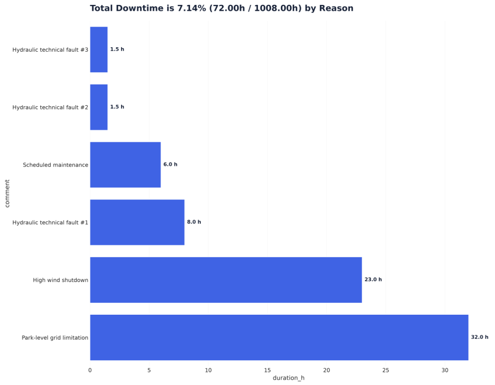 

To prevent double-counting energy losses, I verified that no overlapping 10-minute stop intervals existed for the same turbine. Additionally, periods with recorded operational stops would be excluded from unexplained energy loss calculations, ensuring that each turbine's production shortfall was counted only once.

## Expected Production & Energy Loss Estimation

### How calculations was performed ###
During turbine-level analysis, I merged different datasets using common features, such as timestamp and turbine_id.

For most calculations, I used the median as a reference value. To estimate expected energy production, I calculated the median production of all turbines at similar wind speeds, excluding periods affected by registered stop events.

Finally, I compared actual and expected production to identify potential energy losses and underperforming turbines.

The table below shows the estimated energy losses by cause during the 7-day period.

| Cause | Estimated energy loss (kWh) |
|:------|----------------------------:|
| Extreme wind conditions (WND) | 34845.00 |
| Grid limitation (GRD) | 22241.4 |
| Technical faults (FLT) | 6577.76 |
| Scheduled maintenance (MTN) | 3857.790 |
| Unexplained | 24542.35 |
| **Total** | **92064.3** |

Unexplained losses were identified by comparing actual turbine production with the median production at a given wind speed. 

The chart provided bwlow compares expected and actual energy production for T01, T04, and T06. T01 and T06 generally follow expected production, while T04 consistently underperforms, particularly at higher production levels (220–225 kWh vs. 245–250 kWh expected per 10 minutes). Significant drops may be related to operational stops, while T04's consistent shortfall suggests potential efficiency issues requiring further investigation.

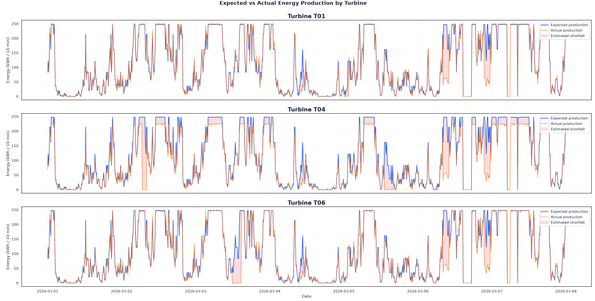

The chart below highlights sudden drops in both expected and actual production. These simultaneous decreases may be explained by changes in wind speed, as the expected production baseline is calculated using wind speed intervals. However, drops in actual production while expected production remains high may indicate operational interruptions or other performance issues.

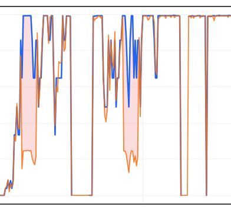

## Recommendations, Limitations & TODO

### Recommendations ###
1. Optimize maintenance scheduling: To keep wind turbines operating efficiently, ensure that technical maintenance is performed on time. For example, T04 was expected to generate 105.44 MWh per week but produced only 95.22 MWh, representing a 9.69% production deficit (10.22 MWh). At an electricity market price of €282/MWh, this deficit would be worth approximately €2,882 per week or €12,352 over 30 days, assuming the same daily deficit and electricity price. I would recommend investigating the reasons for T04's underperformance.

2. Determine the reasons behind the approximately 75–90% drops in energy production during GRD events. I would request grid restriction logs from the operator, including event timestamps and applied power limits, to investigate whether there are opportunities to optimize production within the permitted limits.

3. Before scheduling maintenance (MTN), check the weather forecast for the next 24–48 hours. Where possible, schedule maintenance during periods of lower expected wind speeds to minimize potential energy production losses.

### TODO: ###
1. I found really interesting thing, that not all turbines was affected the same amount by limitations (GDR 'status_code'). I would dive deep into:
    1. Why T02 was not affected by GDR event at 2026-03-06 08:10:00
    2. Why T06 was not affected by GDR event at 2026-03-06 21:30:00

2. Improve expected production estimation based on historical performance and technical specifications

3. Automate anomaly detection by implementing automated monitoring and alerts system to identify unexpected abnormal behavior quickly

### Limitations: ###
1. Limited dataset: The provided datasets cover only one week. For a more accurate and reliable analysis, a larger dataset covering a longer period would be necessary.

2. If the actual production was below the median, the difference was considered an unexplained energy loss. In a real-world scenario, I would investigate the turbine characteristics in greater detail, determine a reasonable deviation threshold, and apply it to the production environment.

3. WND (High Wind Shutdown) loss estimation: The estimated losses during high-wind shutdowns are purely theoretical. In practice, shutting down turbines under extreme wind conditions is a necessary safety measure, meaning that the estimated energy should not be considered a recoverable loss. The theoretical calculation assumes that turbines could continue operating under extreme wind conditions, which does not reflect a realistic or safe operating scenario.

4. Limited weather information: The provided weather data includes only wind speed. The model does not account for wind direction, air density, or other environmental factors that could influence energy production. Including these parameters would help improve the accuracy of the estimates.